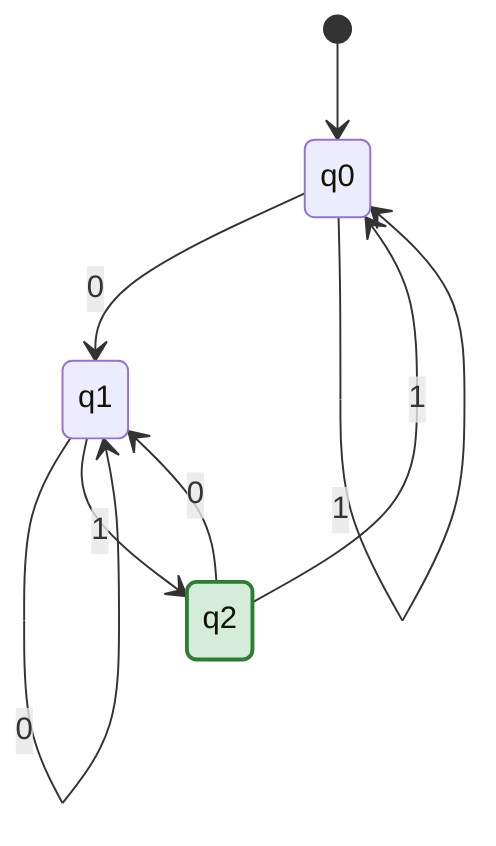

AI usage: yes — this README was produced with AI assistance.

# HW12 — Computational Theory: Automata, Grammars, Lambda Calculus, and Turing Machines

## Overview

This is a single-file study guide for four classical views of computation:

1. **Finite state machines** — computation as moving between a finite number of states.
2. **Grammars** — computation as rewriting symbols according to rules.
3. **Lambda calculus** — computation as building and applying functions.
4. **Turing machines** — computation as a mechanical process on an unbounded tape.

The organizing question is:

> **How much memory does a model need, and what languages can it recognize?**

The answer gives the Chomsky hierarchy. At the top, Turing machines and the
untyped lambda calculus turn out to have exactly the same power. The halting
problem shows that even this top level has hard limits, and the Church–Turing
thesis says that the top level captures everything we mean by “effectively
computable.”

> **TL;DR**
>
> ```text
> finite memory        → regular languages        → DFA / NFA / regex
> one stack            → context-free languages   → CFG / PDA
> linearly bounded tape → context-sensitive       → CSG / LBA
> unbounded tape       → recursively enumerable   → Turing machine
> functions + rewriting → all computable functions → untyped λ-calculus
> ```
>
> The last two rows have the same computational power. The first three are
> increasingly powerful restrictions of it. The halting problem is undecidable,
> so no algorithm can decide in advance whether every program will stop.

## Contents

- [0. The big picture](#0-the-big-picture)
- [1. Finite State Machines](#1-finite-state-machines)
- [2. Grammars and the Chomsky Hierarchy](#2-grammars-and-the-chomsky-hierarchy)
- [3. Lambda Calculus](#3-lambda-calculus)
- [4. Turing Machines](#4-turing-machines)
- [5. How the Four Models Fit Together](#5-how-the-four-models-fit-together)
- [6. Glossary](#6-glossary)
- [7. Self-Check](#7-self-check)
- [8. Further Reading](#8-further-reading)

---

## 0. The big picture

The four models are not four unrelated subjects. They are four ways of
describing the same ladder of computational power:

```text
                    more power, more memory
                              ▲
                              │
  Type 0 / Turing machine / λ-calculus      recursively enumerable
  ┌───────────────────────────────────────┐
  │ recursive / total Turing machine      │  always halts
  │  ┌─────────────────────────────────┐  │
  │  │ Type 1 / context-sensitive      │  │  linear-bounded tape
  │  │  ┌───────────────────────────┐  │  │
  │  │  │ Type 2 / context-free     │  │  │  one stack
  │  │  │  ┌─────────────────────┐  │  │  │
  │  │  │  │ Type 3 / regular    │  │  │  │  finite memory
  │  │  │  └─────────────────────┘  │  │  │
  │  │  └───────────────────────────┘  │  │
  │  └─────────────────────────────────┘  │
  └───────────────────────────────────────┘
```

Each `⊂` below denotes a **proper** inclusion:

```text
Type 3 ⊂ Type 2 ⊂ Type 1 ⊂ Recursive ⊂ Type 0
regular  CFL      CSL       decidable    RE
DFA/NFA  PDA      LBA       total TM     TM
```

“Recursive” is not one of Chomsky’s four types. It sits between Type 1 and
Type 0: every context-sensitive language is decidable, but not every decidable
language is context-sensitive.

| Lens | What computation looks like | Memory | Typical use |
|---|---|---|---|
| Finite state machine | state + input symbol → next state | finite control only | lexers, protocols, controllers |
| Grammar | rewrite rules generate strings | stack (CFG) or linear tape (CSG) | parsers, DSLs, language syntax |
| Lambda calculus | functions + substitution | none explicit; data is encoded | functional programming, semantics |
| Turing machine | tape + head + finite control | unbounded tape | general computation, limits |

### Notation used in this document

| Symbol | Meaning |
|---|---|
| `Σ` | finite input alphabet |
| `Σ*` | all finite strings over `Σ`, including the empty string `ε` |
| `ε` | empty string |
| `len(w)` | length of string `w` |
| `2^Q` | power set of `Q` |
| `δ` | transition function |
| `δ*` | transition function extended to whole strings |
| `⇒`, `⇒*` | derives in one step / in zero or more steps |
| `→`, `→*` | beta-reduces in one step / in zero or more steps |
| `→η` | eta-reduces in one step |
| `⇓` | evaluates to (big-step semantics) |
| `≡α` | alpha-equivalent (differ only by bound-variable names) |
| `⊔` | blank tape symbol |
| `⟨M⟩` | a finite encoding of machine `M` as a string |
| `⊢` | yields (one machine step) |

---

## 1. Finite State Machines

### 1.1 Formal definition

A **deterministic finite automaton** (DFA) is a 5-tuple

```text
M = (Q, Σ, δ, q0, F)

Q      finite, non-empty set of states
Σ      finite input alphabet
δ      Q × Σ → Q                 total transition function
q0 ∈ Q start state
F ⊆ Q  set of accepting (final) states
```

The transition function is the whole program. Given the current state and the
next input symbol, it says exactly which state comes next. There is no other
memory: no counter, no stack, no tape.

The language accepted by `M` is

```text
L(M) = { w ∈ Σ* : δ*(q0, w) ∈ F }
```

where `δ*` extends `δ` from one symbol to a whole string:

```text
δ*(q, ε)  = q
δ*(q, xa) = δ(δ*(q, x), a)       for x ∈ Σ*, a ∈ Σ
```

A DFA reads its input once, left to right, and stops after the last symbol.
Its entire configuration is just its current state. Because there are
finitely many states, a DFA always halts after exactly `|w|` transitions.
In the language of computability, every DFA is a **decider** for its language.

If `δ` is allowed to be partial, a missing transition means “reject” (or we add
one non-accepting **sink state** to make the function total). Both conventions
describe the same class of languages.

### 1.2 State transitions: table, diagram, and a run

Let us build a DFA over `Σ = {0, 1}` that accepts exactly the strings ending in
`01`.

The machine needs to remember only the useful suffix of the input:

| State | Meaning |
|---|---|
| `q0` | nothing useful seen yet (or the last symbol was `1`) |
| `q1` | the last symbol was `0` |
| `q2` | the last two symbols were `01` — accepting |

The **state-transition table** is:

| State | on `0` | on `1` |
|---|---|---|
| `→ q0` | `q1` | `q0` |
| `q1` | `q1` | `q2` |
| `* q2` | `q1` | `q0` |

Here `→` marks the start state and `*` marks an accepting state. The same
information as a state-transition diagram:



`q2` is the only accepting state. It does **not** mean “stop here”: the DFA
keeps consuming symbols, and acceptance is checked only after the input ends.

Run on `00101`:

| Step | Symbol read | State after | Last two symbols seen |
|---:|---|---|---|
| 0 | — | `q0` | — |
| 1 | `0` | `q1` | `0` |
| 2 | `0` | `q1` | `00` |
| 3 | `1` | `q2` | `01` |
| 4 | `0` | `q1` | `10` |
| 5 | `1` | `q2` | `01` |

The run ends in `q2`, so `00101` is accepted. On `010`, the run is
`q0 → q1 → q2 → q1`, which ends outside `F`, so `010` is rejected. Notice how
the state “forgets” older symbols: only the last two bits matter, and a state
can remember exactly that much.

### 1.3 NFA and the subset construction

A **nondeterministic finite automaton** (NFA) differs in two ways:

- one state and symbol may have several possible next states;
- transitions on the empty string `ε` are allowed.

Formally, `δ : Q × (Σ ∪ {ε}) → 2^Q`. An NFA accepts a string if **some** path
through the machine ends in an accepting state. It does not need every path to
accept.

For the “ends in `01`” language, an NFA can simply guess where the final `01`
begins:

```text
q0 --0,1--> q0          (stay before the guessed suffix)
q0 --0-----> q1         (guess: the final 01 starts here)
q1 --1-----> q2         (accept)
F = {q2}
```

This NFA is easy to understand, but nondeterminism does not add power. Every
NFA can be converted to a DFA by the **subset construction**:

- a DFA state is a subset of NFA states;
- the start state is the `ε`-closure of `{q0}`;
- after reading `a`, follow all `a`-transitions from every state in the subset
  and take the `ε`-closure of the result;
- a subset is accepting if it contains at least one NFA accepting state.

The resulting DFA can have up to `2^|Q|` states, so the conversion may be
exponential, but the recognized language is the same. Together with Kleene’s
theorem, this gives the fundamental equivalence:

```text
DFA  ≡  NFA  ≡  regular expression  ≡  right-linear grammar
```

They are different notations for the **regular languages**.

### 1.4 What finite memory cannot do

A DFA cannot count without bound. It can remember “I have seen two zeros” with
two states, but it cannot remember “I have seen `n` zeros” for arbitrary `n`,
because that would require infinitely many states.

The standard proof tool is the **pumping lemma for regular languages**:

```text
If L is regular, there is a pumping length p ≥ 1 such that
every s ∈ L with |s| ≥ p can be written s = xyz satisfying

    |xy| ≤ p,    |y| ≥ 1,    and    x y^i z ∈ L for every i ≥ 0.
```

Intuitively, a long input must repeat some state; the loop `y` can be pumped
any number of times without leaving the language.

**Example.** `L = { 0^n 1^n : n ≥ 0 }` is not regular.

Assume it is regular and let `p` be its pumping length. Choose
`s = 0^p 1^p`, which is in `L`. Since `|xy| ≤ p`, the pumped part `y` consists
only of zeros. Pumping once (`i = 2`) gives a string with more zeros than ones,
which is not in `L`. Contradiction. Therefore `L` is not regular.

The same argument shows that these languages are not regular:

- balanced parentheses `{ (), (()), (()()), ... }`;
- palindromes `{ w : w = reverse(w) }`;
- `{ a^n b^n c^n : n ≥ 0 }`;
- `{ ww : w ∈ {0,1}* }` (the copy language).

A finite automaton can recognize only properties that need **bounded** memory.
That is a limitation, but it is also why DFAs are so fast: recognition is
linear time and constant space.

> **Careful:** real-world “regular expressions” often include backreferences,
> lookaround, or recursion. Those features can recognize non-regular languages.
> The theoretical regular expressions are exactly the DFA languages.

### 1.5 Where finite state machines appear

Finite automata are everywhere in practical computing:

- lexical analyzers (tokenizers) in compilers;
- regular-expression search;
- network protocols and TCP state machines;
- vending machines, traffic lights, elevators, and device controllers;
- UI navigation and game-character AI;
- hardware control units and digital circuits;
- model checking of finite-state systems.

When a problem needs unbounded counting or nested matching, a finite automaton
is the wrong tool. The next rung of the ladder adds a stack.

---

## 2. Grammars and the Chomsky Hierarchy

### 2.1 Grammars generate languages

A **formal grammar** is a 4-tuple

```text
G = (V, Σ, R, S)

V      finite set of nonterminal symbols (variables)
Σ      finite set of terminal symbols, with V ∩ Σ = ∅
R      finite set of productions (rewrite rules)
S ∈ V  start symbol
```

A production is written `α → β`, where `α` and `β` are strings over
`V ∪ Σ`. A **derivation step** replaces an occurrence of `α` by `β`:

```text
γ α δ  ⇒  γ β δ
```

`⇒*` means zero or more derivation steps. The language generated by `G` is

```text
L(G) = { w ∈ Σ* : S ⇒* w }
```

The grammar **generates** strings; an automaton **recognizes** them. These are
two views of the same language classes.

**Example.** The grammar

```text
S → a S b
S → ε
```

generates `{ a^n b^n : n ≥ 0 }`. A derivation of `aabb` is

```text
S ⇒ aSb ⇒ aaSbb ⇒ aabb
```

and the parse tree is

```text
        S
      / | \
     a  S  b
      / | \
     a  S  b
        ε
```

The tree records which production was used at each step. The frontier of the
tree, read left to right, is the generated string.

### 2.2 Context-free grammars

A **context-free grammar** (CFG) restricts every production to the form

```text
A → γ        where A ∈ V and γ ∈ (V ∪ Σ)*
```

The left side is a single nonterminal. This is what “context-free” means: `A`
can be replaced no matter what symbols surround it. In a context-sensitive
grammar, the rule may require a specific context, e.g.
`α A β → α γ β`.

CFGs are the standard model for programming-language syntax. A small expression
grammar is

```text
E → E + T | T
T → T * F | F
F → ( E ) | id
```

This grammar enforces the usual precedence: multiplication binds tighter than
addition, and parentheses override it. The derivation

```text
E ⇒ E + T
  ⇒ T + T
  ⇒ F + T
  ⇒ id + T
  ⇒ id + T * F
  ⇒ id + F * F
  ⇒ id + id * F
  ⇒ id + id * id
```

produces `id + id * id`.

A CFG can also describe nested structure:

```text
S → ( S ) S | ε
```

generates balanced parenthesis strings. A derivation of `()()` is

```text
S ⇒ (S)S ⇒ ()S ⇒ ()(S)S ⇒ ()()S ⇒ ()()
```

Each arrow uses exactly one production.

Two standard facts connect CFGs to automata:

- every CFG language can be recognized by a **nondeterministic pushdown
  automaton** (PDA);
- every language accepted by a PDA has a CFG.

The PDA’s stack supplies exactly the unbounded last-in-first-out memory that a
DFA lacks. Deterministic PDAs are weaker than nondeterministic ones: they
recognize the **deterministic context-free languages**, a proper subset of the
CFLs. Even-length palindromes `{ w w^R }` are context-free but not
deterministic context-free.

Membership for a CFG is decidable. After converting the grammar to **Chomsky
Normal Form** (productions `A → BC` and `A → a`), the **CYK algorithm** decides
whether `w ∈ L(G)` in `O(|w|^3)` time.

### 2.3 Ambiguity and parse trees

A grammar is **ambiguous** if some string has two different parse trees (or,
equivalently, two different leftmost derivations). Consider

```text
E → E + E | E * E | id
```

For `id + id * id`, there are two parses:

```text
(id + id) * id          id + (id * id)
```

Both are derivable because the grammar does not say whether `+` or `*` binds
tighter. The earlier grammar with separate `E`, `T`, and `F` levels is
unambiguous and gives only the second meaning.

Ambiguity is a property of the **grammar**, not necessarily of the language.
Some context-free languages are **inherently ambiguous**: every grammar for
them is ambiguous. A classic example is

```text
{ a^i b^j c^k : i = j or j = k }
```

Ambiguity does not make membership undecidable; CYK still works. It does make
the grammar less useful for a compiler, because the parser would not know which
tree to choose.

### 2.4 The Chomsky hierarchy

Noam Chomsky classified grammars by the shape of their productions. Each type
corresponds to a recognizer with a different amount of memory.

| Type | Name | Productions | Recognizer | Language class |
|---|---|---|---|---|
| 3 | regular | `A → aB`, `A → a`, or `A → ε` | DFA / NFA | regular |
| 2 | context-free | `A → γ` | nondeterministic PDA | context-free |
| 1 | context-sensitive | `αAβ → αγβ`, with `γ ≠ ε` | linear-bounded NTM | context-sensitive |
| 0 | unrestricted | `α → β`, `α` contains a nonterminal | Turing machine | recursively enumerable |

In Type 3, `A` and `B` are nonterminals and `a` is a terminal. The rules are
**right-linear**; left-linear rules (`A → Ba`) give the same class. A grammar
that mixes left- and right-linear rules can generate a non-regular language.

In Type 1, `α` and `β` are arbitrary contexts and `A` is a nonterminal. An
equivalent definition uses **monotone** productions `α → β` with
`|α| ≤ |β|`; the two definitions agree except for the empty string. Type 1
grammars are recognized by a **linear-bounded automaton** (LBA), a Turing
machine whose tape is limited to the input length (up to a constant factor).

Type 0 has no restriction beyond “the left side contains a nonterminal.” These
grammars generate exactly the **recursively enumerable** languages, the same
class recognized by Turing machines.

The inclusions are strict:

```text
Type 3 ⊂ Type 2 ⊂ Type 1 ⊂ Recursive ⊂ Type 0
```

Examples at each level; the rows after the first also witness a strict inclusion:

| Language | Class | Why it is not lower |
|---|---|---|
| strings ending in `01` | regular | — |
| `{ a^n b^n : n ≥ 0 }` | context-free | not regular: pumping lemma |
| `{ a^n b^n c^n : n ≥ 0 }` | context-sensitive | not context-free: a PDA has only one stack |
| `{ ww : w ∈ {0,1}* }` | context-sensitive | not context-free: needs to compare two copies |
| halting problem `HALT` | recursively enumerable | not recursive: halting problem |
| complement of `HALT` | not RE | complement of an RE-complete set |

The last two rows are the subject of Section 4. The language `{ a^n b^n c^n }`
is the standard example of a context-sensitive language that is not
context-free: matching two independent counts needs more than one stack.

### 2.5 Closure properties at a glance

| Class | Union | Intersection | Complement | Concatenation | Kleene star |
|---|---|---|---|---|---|
| Regular | yes | yes | yes | yes | yes |
| Context-free | yes | no | no | yes | yes |
| Context-sensitive | yes | yes | yes | yes | yes |
| Recursively enumerable | yes | yes | no | yes | yes |

Some details worth remembering:

- CFLs are not closed under intersection or complement, but the intersection of
  a CFL with a **regular** language is always context-free.
- Every context-sensitive language is decidable. The closure of CSLs under
  complement is the Immerman–Szelepcsényi theorem, a surprisingly deep result.
- RE languages are not closed under complement. If they were, the halting
  problem would be decidable, which it is not.
- Regular and context-free emptiness are decidable (given a grammar or
  automaton). The emptiness problem for context-sensitive grammars is
  undecidable, even though each fixed context-sensitive language is decidable;
  membership for a given grammar and string is decidable in polynomial space.

### 2.6 Grammars in practice

Grammars are the bridge between theory and programming languages:

- **BNF** (Backus–Naur Form) is a CFG notation used to define language syntax.
- Parser generators such as `yacc`, `bison`, and ANTLR take a grammar and build
  a parser.
- Lexers use regular expressions/DFAs; parsers use CFGs/PDAs.
- JSON, XML, and programming-language syntax are usually specified with
  context-free grammars.
- Natural-language syntax needs more than CFGs for some phenomena (for example,
  cross-serial dependencies in Dutch), which motivates mildly context-sensitive
  formalisms.
- Compiler optimizations must respect the undecidability limits from Section 4:
  a compiler cannot decide every semantic property of every program.

The grammar/automaton pairs are the same ladder seen from two directions:

```text
regular grammar      ↔ DFA / NFA
context-free grammar ↔ PDA
context-sensitive    ↔ linear-bounded automaton
unrestricted grammar ↔ Turing machine
```

---

## 3. Lambda Calculus

### 3.1 Syntax and reduction

The **untyped lambda calculus** has only three kinds of terms:

```text
M ::= x          variable
    | λx. M      abstraction (a function of x)
    | M M        application (call the first term on the second)
```

Conventions:

- application is left-associative: `M N P` means `(M N) P`;
- abstraction extends as far right as possible: `λx. M N` means `λx. (M N)`;
- `λx.λy.M` is often written `λxy.M`.

Examples:

```text
λx. x                 identity function
λx. λy. x             “first” / Church true
λx. x x               self-application
(λx. x) y             apply identity to y
```

There are three basic conversions:

```text
α-conversion:   λx. M  ≡α  λy. M[x := y]     if y is not free in M
β-reduction:    (λx. M) N  →  M[x := N]      (both use capture-avoiding substitution)
η-conversion:   λx. M x  →η  M               if x is not free in M
```

`M[x := N]` means “replace free occurrences of `x` in `M` by `N`.” The
substitution must avoid **variable capture**. For example,

```text
(λx. λy. x) y
```

must **not** become `λy. y`, because the free `y` would be captured by the
inner `λy`. Rename the bound variable first:

```text
(λx. λz. x) y  →  λz. y
```

This is alpha-conversion followed by beta-reduction. Getting substitution right
is the main subtlety of implementing lambda calculus.

A simple reduction:

```text
(λx. λy. x) a b
→ (λy. a) b
→ a
```

The term `(λx. λy. x) a b` is the “first of two arguments” function: it returns
`a` and discards `b`.

### 3.2 Free variables, closed terms, and closures

The free variables of a term are defined by

```text
FV(x)       = {x}
FV(λx. M)   = FV(M) \ {x}
FV(M N)     = FV(M) ∪ FV(N)
```

A **closed term** is a term with no free variables: `FV(M) = ∅`. A closed term
is self-contained; an evaluator can run it starting from an empty environment.

```text
λx. x                 closed
λx. λy. x             closed
λx. y                 not closed: y is free
```

A **combinator** is a closed lambda term. The classic combinators are

```text
I = λx. x
K = λx. λy. x
S = λx. λy. λz. x z (y z)
```

Every closed term can be built from `S` and `K` alone; this is **combinatory
logic**, another Turing-complete model of computation.

#### The “closed package” interpretation: closures

In programming languages, a **closure** is a function value packaged together
with the environment in which it was defined. It is a “closed package” because
the code plus its captured variables is self-contained.

```text
let add   = λx. λy. x + y
let add10 = add 10
add10 5   → 15
```

The value of `add10` is not just the code `λy. x + y`; it is the pair

```text
(code = λy. x + y, environment = { x ↦ 10 })
```

so the free `x` can be found when the function is eventually called. An
interpreter can write the rule as

```text
ρ ⊢ λx. M  ⇓  ⟨λx. M, ρ⟩

apply ⟨λx. M, ρ⟩ to v  =  evaluate M under ρ[x ↦ v]
```

where `ρ` is the current environment. **Closure conversion** makes this
explicit in a compiler: free variables are replaced by fields of an environment
record, and the function is compiled to take that record as an extra argument.

The two meanings of “closed” are related:

- a **closed term** needs no environment at all;
- a **closure** closes an open term by pairing it with an environment.

Neither is a new computational model. Closures are how ordinary languages
implement first-class functions; the underlying theory is still lambda
calculus.

### 3.3 Church encodings

Pure lambda calculus has no numbers, booleans, or data structures. They are
encoded as functions. The standard **Church encodings** are:

| Name | Lambda term |
|---|---|
| `TRUE` | `λx. λy. x` |
| `FALSE` | `λx. λy. y` |
| `IF` | `λp. λt. λe. p t e` |
| `AND` | `λp. λq. p q p` |
| `OR` | `λp. λq. p p q` |
| `NOT` | `λp. p FALSE TRUE` |
| `0` | `λf. λx. x` |
| `1` | `λf. λx. f x` |
| `2` | `λf. λx. f (f x)` |
| `3` | `λf. λx. f (f (f x))` |
| `SUCC` | `λn. λf. λx. f (n f x)` |
| `PLUS` | `λm. λn. λf. λx. m f (n f x)` |
| `MULT` | `λm. λn. λf. m (n f)` |
| `ISZERO` | `λn. n (λx. FALSE) TRUE` |

A Church numeral is a “do this `n` times” function: `n f x` applies `f` to `x`
exactly `n` times. For example,

```text
PLUS 1 1
= (λm. λn. λf. λx. m f (n f x)) 1 1
→ λf. λx. 1 f (1 f x)
→ λf. λx. 1 f (f x)
→ λf. λx. f (f x)
= 2
```

The predecessor function `PRED` is more intricate, but it is also encodable
using pairs; it is not needed to understand the main idea. The important point
is that **all computable data and control flow can be represented by functions
alone**.

### 3.4 Recursion and the Y combinator

Lambda calculus has no assignment and no function names inside the calculus. A
function cannot refer to itself by name. How can it recurse?

The answer is a **fixed-point combinator**. The most famous one is

```text
Y = λf. (λx. f (x x)) (λx. f (x x))
```

It satisfies the fixed-point equation

```text
Y f  →*  f (Y f)
```

Reduction:

```text
Y f
→ (λx. f (x x)) (λx. f (x x))
→ f ((λx. f (x x)) (λx. f (x x)))
= f (Y f)
```

So `Y f` is a term `v` with `v = f v`. If `f` is the “one step” of a
recursive definition, then `Y f` is the recursive function.

For factorial, define the non-recursive step

```text
F = λf. λn. IF (ISZERO n) 1 (MULT n (f (PRED n)))
FACT = Y F
```

Under normal order (or in a lazy language), the chain unfolds as

```text
FACT 3
→* 3 * (FACT 2)
→* 3 * (2 * (FACT 1))
→* 3 * (2 * (1 * (FACT 0)))
→* 3 * (2 * (1 * 1))
= 6
```

The arrows hide many beta steps. The key is that `FACT` is a **closed term**:
recursion is created by self-application, not by an external name.

`Y` itself is a closed term and a combinator. In a normal-order or lazy
setting, it is the theoretical reason why a language with first-class functions
and substitution can express recursion without a special `def` or `let rec`
construct.

#### Call-by-value and the Z combinator

The reduction `Y f → f (Y f)` keeps unfolding. Under **normal order** (reduce
the outermost, leftmost redex first), the unfolding stops when the recursive
branch is not needed. Under **call-by-value** (evaluate arguments first), the
argument `x x` is evaluated eagerly and `Y f` diverges:

```text
Y f → (λx. f (x x)) (λx. f (x x))
    → f (x x)          with x = λx. f (x x)
    → f (f (x x))      the argument keeps expanding
    → ...
```

The call-by-value variant is the **Z combinator**, which wraps the recursive
call in a thunk `λv. ... v`:

```text
Z = λf. (λx. f (λv. (x x) v)) (λx. f (λv. (x x) v))
```

Now `Z f` reduces to `f (λv. (Z f) v)`: the recursive call is suspended until
the function actually needs it. The same idea in Python:

```python
Z = (lambda f:
        (lambda x: f(lambda *args: x(x)(*args)))
        (lambda x: f(lambda *args: x(x)(*args))))

fact = Z(lambda f: lambda n: 1 if n == 0 else n * f(n - 1))
print(fact(5))  # 120
```

This Python version is the call-by-value variant. The inner lambdas are
closures: they capture `f` and `x`, which is exactly the “code + environment”
package from Section 3.2. It is a compact demonstration of both ideas at once.

### 3.5 Evaluation order and confluence

Two common reduction strategies are:

| Strategy | Rule | Behavior |
|---|---|---|
| Normal order | reduce the leftmost outermost redex | lazy; can terminate when other strategies do not |
| Applicative order | reduce the leftmost innermost redex | call-by-value; evaluates arguments eagerly |

The term

```text
Ω = (λx. x x) (λx. x x)
```

reduces to itself forever: `Ω → Ω`. It has no normal form. Under normal order,

```text
(λx. 42) Ω  →  42
```

because the function ignores its argument. Under call-by-value, `Ω` is
evaluated before the call, so the whole term diverges.

The **Church–Rosser theorem** says that beta-reduction is **confluent**: if a
term can reduce to two different terms, those two terms can always be reduced
to a common term. Consequently, a normal form is unique up to alpha-equivalence.
Different evaluation orders may change whether a normal form is found and how
many steps it takes, but not what the normal form is.

### 3.6 Typed versus untyped lambda calculus

The untyped calculus allows any term to be applied to any other term. That is
what makes it Turing-complete, and also what allows `Ω` and non-termination.

The **simply typed lambda calculus** adds types:

```text
Γ, x : A ⊢ x : A

Γ, x : A ⊢ M : B
────────────────────
Γ ⊢ λx. M : A → B

Γ ⊢ M : A → B      Γ ⊢ N : A
──────────────────────────────
Γ ⊢ M N : B
```

Well-typed terms are **strongly normalizing**: every reduction sequence
terminates. Therefore the simply typed lambda calculus is **not**
Turing-complete. In particular, the Y combinator cannot be typed: a fixed-point
combinator would let us write non-terminating terms, contradicting strong
normalization.

This is a fundamental trade-off:

- **untyped / general recursion** → all computable functions, but no guarantee
  that a program terminates;
- **strong types** → termination and good static guarantees, but some programs
  are excluded;
- practical typed languages often add general recursion, recursive types, or a
  special fixed-point operator to regain Turing completeness.

The untyped lambda calculus is Turing-complete: it computes exactly the same
functions as a Turing machine. The Church–Turing thesis then says that this
class is the class of all effectively computable functions. The class of
λ-definable functions is also closed under composition, primitive recursion,
and minimization—the operations that define the μ-recursive functions—which is
another way to see why the two models coincide.

---

## 4. Turing Machines

### 4.1 Definition and configurations

A **Turing machine** (TM) is a 7-tuple

```text
M = (Q, Γ, b, Σ, δ, q0, F)

Q      finite set of states
Γ      finite tape alphabet
b ∈ Γ  blank symbol
Σ ⊆ Γ \ {b}   input alphabet
δ      Q × Γ ⇀ Q × Γ × {L, R}    partial transition function
q0 ∈ Q start state
F ⊆ Q  accepting states
```

The tape is infinite in both directions (a one-way infinite tape gives the same
power). Initially it contains the input string `w ∈ Σ*`, followed by blanks,
with the head on the first symbol. A transition

```text
δ(q, a) = (q', b, D)
```

means: in state `q`, reading `a`, write `b`, move the head one cell in direction
`D` (left or right), and enter state `q'`. If `δ(q, a)` is undefined, the
machine halts; it accepts if the state is in `F`, and rejects otherwise.

A **configuration** records the whole machine state:

```text
u q v
```

where `u` is the tape content to the left of the head, `q` is the current state,
and `v` is the tape content from the head to the right. The initial
configuration is `q0 w`. The step relation `⊢` transforms one configuration
into the next.

Two important kinds of machines:

- A **decider** halts on every input. It decides a language: accept or reject in
  finite time. Its language is **recursive** (decidable).
- A **recognizer** halts and accepts exactly when the input is in the language,
  but it may loop forever on inputs outside the language. Its language is
  **recursively enumerable** (RE).

This distinction is the key to the halting problem.

### 4.2 A worked example

Let us build a TM for

```text
L = { 0^n 1^n : n ≥ 1 }
```

Tape alphabet: `Γ = {0, 1, X, Y, ⊔}`. The algorithm is:

1. Replace the leftmost remaining `0` by `X` and move right.
2. Skip over `0`s and `Y`s until the first `1`; replace it by `Y` and move left.
3. Rewind over `0`s and `Y`s until the `X`; move right to the next `0`.
4. Repeat. When no `0` remains, check that the rest of the tape is all `Y`s.
   Accept if it is; reject otherwise.

The transition table (undefined transitions reject):

| State | Read | Write | Move | Next |
|---|---|---|---|---|
| `q0` | `0` | `X` | R | `q1` |
| `q0` | `Y` | `Y` | R | `q3` |
| `q1` | `0` | `0` | R | `q1` |
| `q1` | `Y` | `Y` | R | `q1` |
| `q1` | `1` | `Y` | L | `q2` |
| `q2` | `0` | `0` | L | `q2` |
| `q2` | `Y` | `Y` | L | `q2` |
| `q2` | `X` | `X` | R | `q0` |
| `q3` | `Y` | `Y` | R | `q3` |
| `q3` | `⊔` | `⊔` | R | `qacc` |

`qacc` is the accepting state. This machine rejects the empty string; to accept
`n = 0` as well, add `q0` on `⊔ → qacc`.

A run on `0011` (the state symbol is written immediately left of the head cell):

```text
q0 0011
⊢ X q1 011
⊢ X0 q1 11
⊢ X q2 0Y1        (wrote Y, moved left)
⊢ q2 X0Y1
⊢ X q0 0Y1
⊢ XX q1 Y1
⊢ XXY q1 1
⊢ XX q2 YY        (wrote Y, moved left)
⊢ X q2 XYY
⊢ XX q0 YY
⊢ XXY q3 Y
⊢ XXYY q3 ⊔
⊢ accept
```

The machine uses `X` to mark processed `0`s and `Y` to mark processed `1`s.
The `X`s also serve as a left boundary for the rewind phase. This is a typical
TM programming pattern: use extra tape symbols to record progress.

### 4.3 Variants and the universal machine

Many apparently stronger machines have exactly the same power:

- **multi-tape TM** — several tapes and heads; simulate with one tape by
  interleaving the tapes with separator symbols (quadratic slowdown);
- **nondeterministic TM** — several possible transitions; accept if some branch
  accepts; simulate all branches breadth-first (exponential slowdown);
- **two-way infinite tape** — simulate with a one-way tape by folding the left
  side onto the right;
- **two-stack PDA** — two stacks can simulate a tape;
- **register machine** — a few unbounded integer registers;
- **lambda calculus**, **μ-recursive functions**, **Post systems**,
  **combinatory logic**, **cellular automata** (Rule 110), and many others.

This robustness is strong evidence for the Church–Turing thesis: changing the
details of the machine does not change the class of computable functions.

A **universal Turing machine** is a TM `U` that takes a description `⟨M⟩` of
another machine and an input `w`, and simulates `M` on `w`:

```text
U(⟨M⟩, w)  =  M(w)
```

This is the theoretical version of a stored-program computer or an interpreter.
It also makes self-reference possible: a machine can be given its own
description as input. That is exactly what the halting proof needs.

A system is **Turing-complete** if it can simulate a Turing machine. Untyped
lambda calculus, Python with unbounded memory, and Conway’s Game of Life are
Turing-complete. Real hardware has finite memory, so a physical computer is
strictly a finite-state machine; the Turing model describes the idealization
with unbounded memory. Complexity theory studies the cost of computation under
resource bounds; computability theory studies what is possible at all.

### 4.4 Halting, non-termination, and undecidability

The informal “downtime” issue is simple to state:

> Given a program and an input, will the program eventually stop, or will it
> run forever?

This is the **halting problem**. Turing proved that no algorithm can decide it
for every program-input pair.

Formally,

```text
HALT = { ⟨M, w⟩ : M halts on input w }
```

**Theorem.** `HALT` is undecidable.

**Proof.** Suppose, for contradiction, that some Turing machine `H` decides
`HALT`. Then `H(⟨M⟩, w)` accepts if `M` halts on `w`, and rejects otherwise.
Build a new machine `D` that takes a machine description `x` and does:

```text
D(x):
    if H(x, x) accepts:     # x halts when run on its own description
        loop forever
    else:                   # x does not halt on its own description
        halt
```

Now run `D` on its own description, `⟨D⟩`:

- If `D` halts on `⟨D⟩`, then `H(⟨D⟩, ⟨D⟩)` accepts, so by construction `D`
  loops forever. Contradiction.
- If `D` does not halt on `⟨D⟩`, then `H` rejects, so by construction `D` halts.
  Contradiction.

Both cases are impossible, so `H` cannot exist. Therefore `HALT` is
undecidable. ∎

The proof is a **diagonal argument**, the same idea as Cantor’s proof that the
real numbers are uncountable and Gödel’s incompleteness theorem. The machine
`D` is constructed to disagree with every row of a hypothetical table of
machine behaviors, including its own row.

Important qualifications:

- **Undecidable does not mean “we do not know.”** It means no single algorithm
  can decide the question for all inputs. Particular programs may be easy to
  analyze, and many are.
- **Halting is semi-decidable.** A universal simulator can run `M` on `w`; if
  `M` halts, the simulator eventually sees it and accepts. If `M` does not halt,
  the simulator runs forever. So `HALT` is recursively enumerable, but not
  recursive.
- **The complement is not RE.** If both `HALT` and its complement were RE, run
  the two semi-decision procedures in parallel (dovetailing); one of them must
  stop, giving a decision procedure. That would make `HALT` decidable, a
  contradiction.
- **The halting problem is not about slow computers.** It is not a performance
  limit. Even with unlimited time and memory, no algorithm can decide it.

### 4.5 Rice’s theorem and practical consequences

Rice’s theorem generalizes the halting problem:

> **Rice’s theorem.** Every non-trivial semantic property of programs is
> undecidable.

A **semantic** property depends on the function the program computes, not on
its source text. “Always returns 0,” “is equivalent to this other program,” and
“halts on every input” are semantic. “Has more than 100 lines” and “contains a
`while` loop” are syntactic and may be decidable.

“Non-trivial” means the property is neither true for all programs nor false for
all programs.

Consequences:

- no general termination checker that accepts exactly the terminating programs;
- no perfect virus or malware detector (malware detection is a semantic
  property);
- no compiler that decides every possible optimization or program equivalence;
- no universal debugger that predicts whether an arbitrary loop will finish;
- static analyzers must be **conservative**: they may say “I don’t know” or
  reject a program that actually terminates.

This is why practical tools restrict the language or the property. Type systems,
termination checkers (Coq, Agda), and finite-state model checkers give up
Turing completeness or generality in exchange for decidability.

### 4.6 The Church–Turing thesis

The **Church–Turing thesis** states:

> Every function that can be computed by an effective, mechanical procedure
> can be computed by a Turing machine.

Equivalently, the following all define the same class of computable functions:

```text
Turing machines
untyped lambda calculus
μ-recursive functions
Post production systems
combinatory logic
register machines
any general-purpose programming language with unbounded memory
```

The thesis is not a theorem in the usual mathematical sense, because
“effective procedure” is an informal notion. It is a **thesis** or a definition:
it identifies the informal idea of “computable” with the formal notion of
“Turing-computable.” Once a formal model is fixed, statements such as “lambda
calculus and Turing machines compute the same functions” are theorems.

The main arguments for the thesis are:

1. **Turing’s analysis of human computation (1936).** A person doing a
   calculation by hand uses a finite set of symbols, a finite number of
   internal states, and a finite set of local actions, with an unbounded supply
   of paper. These assumptions lead directly to a Turing machine. Any
   “mechanical” procedure seems to fit this description.
2. **Convergence of independent models.** Church’s lambda calculus, Kleene’s
   recursive functions, Post’s systems, and Turing’s machines were invented
   independently and proved equivalent. It would be a remarkable coincidence if
   they all missed a larger class of effectively computable functions.
3. **Robustness.** Every reasonable programming language with unbounded memory
   is Turing-complete. Adding arrays, objects, exceptions, or concurrency does
   not add computability; it only changes convenience or efficiency.
4. **Physical evidence.** All known physical computing devices, including
   quantum computers, are Turing-equivalent in computability. Quantum computing
   changes complexity (it may solve some problems much faster), not the set of
   computable functions. Proposed “hypercomputers” are speculative and outside
   standard physics.
5. **No counterexample.** No one has exhibited a concrete, physically
   realizable procedure that computes a function provably outside the
   Turing-computable class.

There are several versions of the thesis:

| Version | Claim | Status |
|---|---|---|
| Standard Church–Turing | every effectively computable function is TM-computable | widely accepted |
| Strong / efficiency thesis | every feasible computation is efficiently simulable by a probabilistic TM | challenged by quantum computing |
| Physical Church–Turing | every physical process is simulable by a TM | open and debated |

The standard thesis says nothing about **efficiency**. A Turing machine may be
exponentially slower than a Python program, and a Python program may be
exponentially slower than the best algorithm. Computability asks “is it
possible in principle?”; complexity asks “at what cost?” The P versus NP
problem lives on the complexity side, not the computability side.

### 4.7 What the thesis does not say

- It does **not** say that every computer is literally a Turing machine. A
  laptop has finite memory and is a finite-state machine; the TM is the
  unbounded-memory idealization.
- It does **not** say that the human brain is a Turing machine. That is a
  separate philosophical claim (computationalism), not a consequence of the
  thesis.
- It does **not** say that every physical process is computable. The physical
  version is a stronger, more controversial claim.
- It does **not** imply that undecidable problems are unimportant or rare in
  practice. Many restricted, practical versions are decidable, and
  semi-decision procedures plus human insight often work well.
- It does **not** make undecidability “go away” with faster hardware or better
  programming languages. The barrier is logical, not technological.

---

## 5. How the Four Models Fit Together

### 5.1 One ladder, four notations

| Model | Memory | Language class | Halting behavior | Example use |
|---|---|---|---|---|
| DFA / NFA | finite control only | regular | always halts | lexers, protocols |
| PDA / CFG | one stack | context-free | may loop; membership decidable | parsers, syntax |
| LBA / CSG | tape linear in input | context-sensitive | may loop; membership decidable | richer grammar formalisms |
| Turing machine | unbounded tape | RE; deciders = recursive | may loop | general computation |
| Untyped λ-calculus | none explicit | all computable functions | may not normalize | functional programming, semantics |

The first three rows are increasingly powerful models below the Turing
machine. The last row is a completely different syntax for the top of the
ladder: untyped lambda calculus and Turing machines are equivalent.

### 5.2 The same result, four ways

- **Finite state machine:** computation is a finite graph of states. Memory is
  the current vertex. The graph cannot grow, so the model captures only
  properties that need a bounded amount of memory.
- **Grammar:** computation is a rewriting system. The shape of the productions
  controls the power: right-linear → regular, single nonterminal on the left →
  context-free, context-sensitive → linear-bounded, unrestricted → RE.
- **Lambda calculus:** computation is substitution. There is no explicit state
  or tape; data and recursion are encoded as functions. Untyped lambda calculus
  is Turing-complete.
- **Turing machine:** computation is mechanical symbol manipulation with an
  unbounded workspace. It is the canonical model for “what a machine can do.”

The grammar/automaton correspondences are exact:

```text
regular grammar      ↔ DFA / NFA
context-free grammar ↔ PDA
context-sensitive    ↔ LBA
unrestricted grammar ↔ TM
```

And the top of the ladder has multiple equivalent formalisms:

```text
TM  ≡  untyped λ-calculus  ≡  μ-recursive functions  ≡  register machines
```

### 5.3 Common misconceptions

- **“An NFA is more powerful than a DFA.”** No. It may be exponentially more
  compact, but every NFA language is regular and has a DFA.
- **“A CFG can describe any language.”** No. CFGs cannot even generate
  `{ a^n b^n c^n }`. Context-sensitive grammars and Turing machines are
  stronger.
- **“Undecidable means nobody knows the answer.”** No. It means no algorithm
  decides the question for all inputs. Specific instances can be settled.
- **“The Church–Turing thesis is a proven theorem.”** It is a thesis about the
  informal notion of effective computability. Equivalence of formal models is
  provable; the thesis itself is not.
- **“Lambda calculus is only a theoretical toy.”** It is the foundation of
  functional programming, type theory, and programming-language semantics. Its
  closures and higher-order functions are in JavaScript, Python, Haskell, and
  Lisp.
- **“A real computer is a Turing machine.”** A real computer has finite memory.
  It is a finite-state machine unless we idealize its storage as unbounded.

---

## 6. Glossary

| English | 中文 | Meaning |
|---|---|---|
| finite state machine | 有限狀態機 | machine with finitely many states and no auxiliary memory |
| deterministic finite automaton (DFA) | 確定性有限狀態自動機 | one transition per state-symbol pair |
| nondeterministic finite automaton (NFA) | 非確定性有限狀態自動機 | several possible transitions; accepts if some path accepts |
| state transition | 狀態轉移 | move from one state to another on an input symbol |
| regular language | 正則語言 / 正規語言 | language recognized by a DFA/NFA |
| grammar | 文法 | rewrite system that generates strings |
| context-free grammar (CFG) | 上下文無關文法 | productions with one nonterminal on the left |
| context-sensitive grammar | 上下文有關文法 | productions that may depend on surrounding symbols |
| Chomsky hierarchy | 喬姆斯基譜系 | four-level classification of grammars and languages |
| recursively enumerable | 遞迴可枚舉 | language recognized by a Turing machine |
| recursive / decidable | 遞迴 / 可判定 | language decided by a Turing machine that always halts |
| lambda calculus | λ演算 | model of computation based on functions and substitution |
| closed term | 封閉項 | lambda term with no free variables |
| closure | 閉包 | function code packaged with its defining environment |
| combinator | 組合子 | closed lambda term |
| Y combinator | Y 組合子 | fixed-point combinator that enables recursion |
| beta reduction | β-歸約 | applying a function by substitution |
| Turing machine | 圖靈機 | finite control plus unbounded tape |
| universal Turing machine | 通用圖靈機 | TM that simulates any other TM from its description |
| halting problem | 停機問題 | decide whether a TM halts on a given input |
| undecidable | 不可判定 | no algorithm can decide it for all inputs |
| Church–Turing thesis | 邱奇–圖靈論題 | effective computability = Turing computability |
| pushdown automaton | 下推自動機 | automaton with a stack; recognizes CFLs |
| linear-bounded automaton | 線性有界自動機 | TM whose tape is linear in the input length |
| parse tree | 剖析樹 / 語法樹 | tree showing the derivation of a string |
| ambiguity | 歧義 | a string has more than one parse tree |

---

## 7. Self-Check

Try these before opening the answers.

1. Why does a DFA always halt, while a Turing machine may not?
2. Use the pumping lemma to explain why `{ a^n b^n }` is not regular.
3. Give a CFG for balanced parentheses and derive `()()`.
4. Which Chomsky type is `{ a^n b^n c^n }`, and why is it not context-free?
5. What is the difference between a closed term and a closure?
6. What does `Y f` reduce to, and why is that useful?
7. Why does the Y combinator diverge under call-by-value, and what fixes it?
8. State the halting problem and sketch the diagonal proof.
9. What does the Church–Turing thesis claim, and why is it not a theorem?
10. Why can a compiler not decide every semantic property of a program?

<details>
<summary>Answers</summary>

1. A DFA has finitely many configurations and reads one symbol per step, so
   it stops after `|w|` steps. A TM can write and move back and forth forever,
   so it may never halt.
2. If `{ a^n b^n }` were regular with pumping length `p`, pump the zeros in
   `a^p b^p`; the result has more zeros than ones, a contradiction.
3. `S → (S)S | ε`; derivation:
   `S ⇒ (S)S ⇒ ()S ⇒ ()(S)S ⇒ ()()S ⇒ ()()`.
4. Type 1 (context-sensitive). A PDA has only one stack and cannot match
   three independent counts; the language is not context-free.
5. A closed term has no free variables (`FV(M) = ∅`). A closure is a runtime
   pair of code and environment; it closes an open term by capturing values.
6. `Y f →* f (Y f)`. It gives a fixed point, so `Y F` is the recursive
   function defined by the step `F`.
7. Call-by-value evaluates `x x` eagerly and unfolds forever. The Z combinator
   wraps the recursive call in a thunk `λv. ... v`, suspending it until needed.
8. `HALT = { ⟨M,w⟩ : M halts on w }` is undecidable. Assume a decider `H`;
   build `D` that loops if `H(D,D)` accepts and halts otherwise. Running `D`
   on itself gives a contradiction in both cases.
9. Every effectively computable function is Turing-computable. “Effectively
   computable” is informal, so the thesis is a definition/empirical hypothesis;
   equivalence of formal models is a theorem.
10. Rice’s theorem: every non-trivial semantic property of programs is
    undecidable. A compiler can decide syntactic properties, but not arbitrary
    properties of the function a program computes.

</details>

---

## 8. Further Reading

- Michael Sipser, *Introduction to the Theory of Computation* — the clearest
  introduction to automata, computability, and complexity.
- John Hopcroft, Rajeev Motwani, and Jeffrey Ullman, *Introduction to Automata
  Theory, Languages, and Computation* — encyclopedic coverage of the Chomsky
  hierarchy and automata.
- Dexter Kozen, *Automata and Computability* — concise and proof-oriented.
- Benjamin Pierce, *Types and Programming Languages* — lambda calculus,
  evaluation, and type systems.
- Henk Barendregt, *The Lambda Calculus: Its Syntax and Semantics* — the
  standard reference for lambda calculus.
- A. M. Turing, “On Computable Numbers, with an Application to the
  Entscheidungsproblem” (1936) — the original Turing machine paper.
- Alonzo Church, “An Unsolvable Problem of Elementary Number Theory” (1936) —
  the lambda calculus and undecidability.
- Noam Chomsky, “Three Models for the Description of Language” (1956) — the
  origin of the Chomsky hierarchy.
- Scott Aaronson, *Quantum Computing since Democritus* — computability,
  complexity, and the Church–Turing thesis from a modern perspective.

---

*End of HW12 study guide.*
